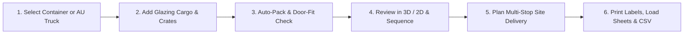

# Zentravo by Glazentri

**Browser-Based 3D Container & Truck Load Planning for Glazing and Construction**

`3D WebGL + 2D Fallback` · `Australian Vehicle Presets` · `Local Browser Storage` · `No Backend Required` · `MIT Licence`

&lt;/div&gt;

**Zentravo** is a free, browser-based **3D container and truck load planner** built specifically for **window, door, glazing, and construction logistics**. Created by **Glazentri** as a specialised build of **İstif** (the open-source load planner by Cuma Ali Dirik), Zentravo helps fabricators, suppliers, and transport teams plan how upright windows, doors, timber crates, A-frame stillages, and building materials fit from **container to truck to site**—with zero desktop installation.

> **Tip:** Add a screenshot or GIF of the 3D container studio here (``) once committed to your repository.

---

## At a Glance

| | |
| :--- | :--- |
| **Built for** | Window & door fabricators, glazing suppliers, builders, and transport planners |
| **Cargo types** | Upright windows & doors, timber crates (with grouped items), and A-frame stillages |
| **Vehicles** | Standard shipping containers + Australian **tautliners, tray trucks, mezzanines, and B-doubles** |
| **Packing engine** | Auto-pack, lock-preserving optimisation, manual 3D placement, and **door-opening clearance checks** |
| **Outputs** | Supplier-branded cargo labels, load sheets, CSV manifests, and JSON plan backups |
| **Runtime** | 100% client-side in the browser (WebGL 3D with automatic **2D top-view fallback**) |

---

## End-to-End Workflow



1. **Choose a vehicle or container** — Pick an Australian vehicle preset or enter custom internal and door-opening dimensions.
2. **Model your cargo** — Add upright windows, doors, timber crates, or A-frame stillages; group items inside crates; and tag each package by supplier and consignment.
3. **Pack & validate fit** — Run auto-pack for unplaced cargo, optimise while preserving locked packages and the packages supporting them, or adjust placements manually in 3D.
4. **Verify loading sequence** — Step through the loading order in interactive 3D (or 2D top view if WebGL is unavailable).
5. **Plan site deliveries & dispatch** — Reuse container cargo for multi-stop truck runs, estimate trip time, fuel, and unloading costs, and export dispatch documents.

---

## Why Zentravo Over Generic 3D Load Planners?

Generic 3D bin-packing software assumes every item is a rigid, flat-packed carton. Glazing and construction freight has physical rules that standard packers miss:

* **Upright & fragile cargo modelling** — Purpose-built support for upright windows and doors, timber crates, and A-frame stillages.
* **Door-opening clearance checks** — Validates package width and height against the **actual door aperture**, not just the internal container or truck cavity.
* **Smart lock-preserving optimisation** — Lock critical crates or stillages in place; re-optimisation respects both locked items and the supporting packages beneath them.
* **Automatic gross mass calculation** — Computes total package weight from grouped contents plus packaging tare mass.
* **Container-to-truck continuity** — Carry cargo straight from an import/export container plan into **multi-stop Australian truck delivery** costing.

---

## Core Capabilities

### 📦 Glazing & Construction Cargo
* Model **upright windows and doors**, **timber crates**, and **A-frame stillages**.
* Group multiple items inside crates and track every package by **supplier** and **consignment**.
* Calculate **gross mass** automatically from combined contents and packaging.

### 📐 3D Packing, Door-Fit & Visualisation
* **Door-fit validation:** Checks width and height against the door opening as well as internal dimensions.
* **Auto-pack & optimisation:** Places unplaced cargo automatically and optimises layouts while keeping locked packages and their supports intact.
* **Interactive 3D + loading playback:** Inspect from any angle, place items manually, and step through the loading sequence.
* **2D top-view fallback:** Automatically switches to a 2D top view when WebGL is unavailable.

### 🚛 Australian Fleet & Multi-Stop Delivery Costing
* Editable container and truck dimensions with **Australian vehicle references** including **tautliners**, **tray trucks**, **mezzanines**, and **B-double combinations**.
* Reuse cargo from the container plan for **multi-stop site deliveries**.
* Estimate **trips, travel time, fuel, and unloading costs** for **manual handling**, **forklift unloading**, or a **combination** of both.

### 🖨️ Dispatch Documents & Backups
* Print **cargo labels** with supplier branding.
* Generate **load sheets** for warehouse and yard teams.
* Export **CSV manifests** for dispatch workflows and save **JSON backups** of complete plans.

---

## What Glazentri Changed (Zentravo vs. Original İstif)

Zentravo builds on the core packing engine, interactive 3D view, step-by-step loading sequence, and manual placement tools from the **Original İstif project** *(add link)*.

| Area | Glazentri Adaptation in Zentravo |
| :--- | :--- |
| **Browser app** | Runs in a browser with no Windows installer. Saves drafts in browser storage and executes packing calculations locally. |
| **Glazing & construction cargo** | Models upright windows/doors, timber crates, and A-frame stillages; groups items inside crates; tracks supplier & consignment; calculates gross mass from contents + packaging. |
| **Door fit & packing** | Checks package width & height against the actual door opening as well as internal space. Auto-pack adds unplaced cargo; optimisation preserves locked packages and supporting packages. |
| **Australian vehicle options** | Editable container & truck dimensions with Australian vehicle references and options for tautliners, tray trucks, mezzanines, and B-doubles. |
| **Truck delivery & handling** | Reuses container cargo for multi-stop site deliveries; estimates trips, travel time, fuel, and unloading costs across manual, forklift, or combined handling. |
| **Dispatch documents** | Prints supplier-branded cargo labels, generates load sheets, exports CSV manifests, and saves JSON plan backups. |

See the **Glazentri change log** *(add link)* for full release notes.

---

## Quick Start: Run Locally

The bundled build runs entirely in your browser with **no backend** and **no API credentials** required.

### Option 1: Run the Pre-Built Standalone Planner

Serve the `public` directory from the repository root using Python 3:

```bash
python3 -m http.server 8080 --directory public
```

Open in your browser:

```text
http://localhost:8080/container-studio/
```

> **Note:** If WebGL is disabled or unavailable in your browser, Zentravo automatically provides a **2D top view** so you can keep planning.

### Option 2: Rebuild from Source & Run Tests

Install dependencies, build the bundle, and run the engine and integration test suite:

```bash
npm install
npm run build
npm test
```

---

## Standalone vs. WinMatch Integration

When running inside **WinMatch** *(add link)*, Zentravo connects directly to your project schedule while preserving your shipping edits.

| Capability | Standalone Browser App | Inside WinMatch Host |
| :--- | :--- | :--- |
| **3D/2D packing, door-fit & Australian trucks** | Included | Included |
| **Browser draft storage & JSON backups** | Included | Included |
| **Branded labels, load sheets & CSV manifest** | Included | Included |
| **Pull windows & doors from project schedule** | — | Requires WinMatch host |
| **Flag changed source dimensions** | — | Requires WinMatch host |
| **Retain confirmed shipping dimensions & manual placements** | — | Requires WinMatch host |
| **Project saving & IFC export** | — | Requires WinMatch host |

---

## Frequently Asked Questions

### Does Zentravo require installation, a backend server, or API keys?
No. The standalone planner runs locally in your browser, saves drafts in browser storage, and runs all packing calculations client-side with no backend or API credentials.

### How does door-fit checking prevent loading-day surprises?
A crate or stillage can sometimes fit inside a container or truck body yet still be too tall or wide to pass through the rear or side doors. Zentravo checks package width and height against both the internal space and the actual door opening.

### Can I lock specific stillages or crates before re-optimising?
Yes. When you run optimisation, Zentravo preserves locked packages as well as any packages underneath that support them.

### Which Australian truck configurations are supported?
Zentravo includes Australian vehicle references and editable dimensions for **tautliners**, **tray trucks**, **mezzanines**, and **B-double combinations**, alongside standard shipping containers.

### What happens if WebGL is unavailable on my device?
Zentravo automatically falls back to a **2D top view** when WebGL is not available.

---

## Credits & Licence

Adapted for **Zentravo** by **Glazentri**.

The original **İstif** components are copyright © 2026 **Cuma Ali Dirik** and retain their **MIT Licence**:
* **İstif licence notice** *(add link)*
