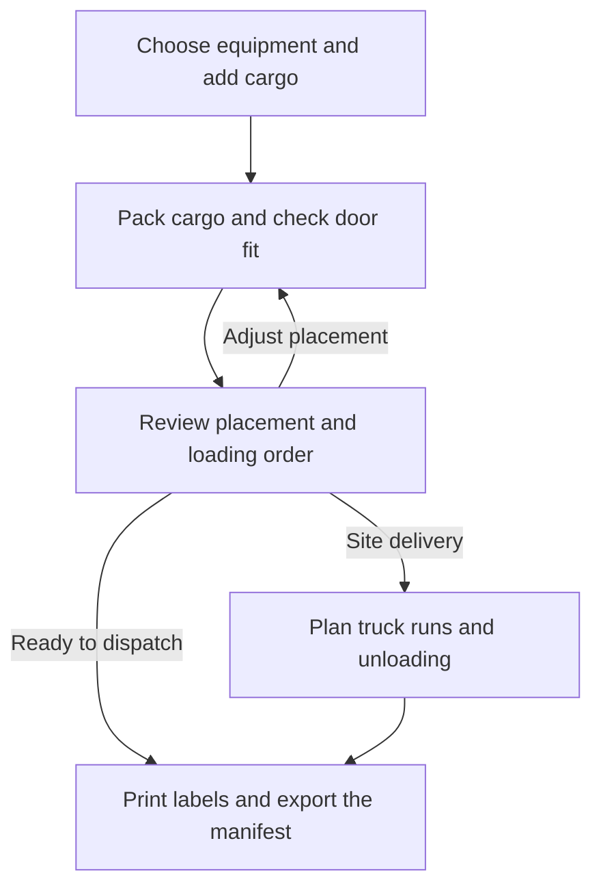

<div align="center">

# Zentravo by Glazentri

**Browser-based 3D container and truck load planning for glazing and construction**

[Download the standalone planner (ZIP)][web-zip] · [Run locally](#run-locally) · [Container / Truck Optimiser in WinMatch][winmatch-planner]

</div>

**Zentravo** is a free, browser-based **3D container and truck load planner** for window, door, glazing and construction logistics. [Glazentri][glazentri] adapted [İstif][istif], the open-source load planner by Cuma Ali Dirik, for fabricators, suppliers and transport teams. Plan how upright windows, doors, timber crates and A-frame stillages fit in a container, then reuse those packages for truck deliveries to site.

---

## At a Glance

| Feature | Details |
| :--- | :--- |
| **Built for** | Window & door fabricators, glazing suppliers, builders, and transport planners |
| **Cargo types** | Upright windows & doors, timber crates (with grouped items), and A-frame stillages |
| **Vehicles** | Standard shipping containers + Australian **tautliners, tray trucks, mezzanines, and B-doubles** |
| **Packing engine** | Auto-pack, lock-preserving optimisation, manual 3D placement, and **door-opening clearance checks** |
| **Outputs** | Supplier-branded cargo labels, load sheets, CSV manifests, and JSON plan backups |
| **Runtime** | 100% client-side in the browser (WebGL 3D with automatic **2D top-view fallback**) |

---

## End-to-End Workflow



1. **Choose a vehicle or container** — Pick an Australian vehicle preset or enter custom internal and door-opening dimensions.
2. **Model your cargo** — Add upright windows, doors, timber crates or A-frame stillages. Group items inside crates and tag each package by supplier and consignment.
3. **Pack & validate fit** — Run auto-pack for unplaced cargo, optimise while preserving locked packages and the packages supporting them, or adjust placements manually in 3D.
4. **Review the loading sequence** — Step through the loading order in 3D. In the 2D top view, use the numbered loading checklist to review each package.
5. **Plan site deliveries & dispatch** — Reuse container cargo for multi-stop truck runs, estimate trip time, fuel, and unloading costs, and export dispatch documents.

---

## Planning for Glazing Freight

A stillage of upright windows can fit inside a container and still be too tall to pass through its doors. Zentravo uses the loaded package dimensions, allowed orientations and door opening when checking fit.

* **Upright & fragile cargo modelling** — Purpose-built support for upright windows and doors, timber crates, and A-frame stillages.
* **Door-opening clearance checks** — Checks package width and height against both the actual door opening and the internal space.
* **Lock-preserving optimisation** — Lock critical crates or stillages in place. Re-optimisation keeps those packages and their supports in position.
* **Automatic gross mass calculation** — Computes total package weight from grouped contents plus packaging tare mass.
* **Container-to-truck continuity** — Carry cargo straight from an import/export container plan into **multi-stop Australian truck delivery** costing.

---

## Core Capabilities

### 📦 Glazing & Construction Cargo

* Model **upright windows and doors**, **timber crates**, and **A-frame stillages**.
* Group multiple items inside crates and track every package by **supplier** and **consignment**.
* Calculate **gross mass** automatically from combined contents and packaging.

### 📐 3D Packing, Door-Fit & Visualisation

* **Door-fit validation** — Check width and height against the door opening and internal dimensions.
* **Auto-pack & optimisation** — Auto-pack places unplaced cargo. Optimise reworks the layout while keeping locked packages and their supports in place.
* **Interactive 3D & loading playback** — Inspect the load from any angle, place items manually and step through the loading sequence.
* **2D top-view fallback** — The planner switches to an interactive top view when WebGL is unavailable.

### 🚛 Australian Fleet & Multi-Stop Delivery Costing

* Editable container and truck dimensions with **Australian vehicle references** including **tautliners**, **tray trucks**, **mezzanines**, and **B-double combinations**.
* Reuse cargo from the container plan for **multi-stop site deliveries**.
* Estimate **trips, travel time, fuel, and unloading costs** for **manual handling**, **forklift unloading**, or a **combination** of both.

### 🖨️ Dispatch Documents & Backups

* Print **cargo labels** with supplier branding.
* Generate **load sheets** for warehouse and yard teams.
* Export **CSV manifests** for dispatch workflows and save **JSON backups** of complete plans.

---

## What Glazentri Changed (Zentravo vs. Original İstif)

Zentravo builds on the core packing engine, interactive 3D view, step-by-step loading sequence and manual placement tools from the [original İstif project][istif].

| Area | Glazentri Adaptation in Zentravo |
| :--- | :--- |
| **Browser app** | Runs in a browser with no Windows installer. Saves drafts in browser storage and executes packing calculations locally. |
| **Glazing & construction cargo** | Models upright windows and doors, timber crates and A-frame stillages. Groups items into crates, tracks supplier and consignment, and calculates gross mass from contents and packaging. |
| **Door fit & packing** | Checks package width and height against the actual door opening and internal space. Auto-pack adds unplaced cargo. Optimisation preserves locked packages and their supports. |
| **Australian vehicle options** | Editable container & truck dimensions with Australian vehicle references and options for tautliners, tray trucks, mezzanines, and B-doubles. |
| **Truck delivery & handling** | Reuses container cargo for multi-stop site deliveries and estimates trips, travel time, fuel and unloading costs for manual, forklift or combined handling. |
| **Dispatch documents** | Prints supplier-branded cargo labels, generates load sheets, exports CSV manifests, and saves JSON plan backups. |

See the [Glazentri change log](./GLAZENTRI_CHANGES.md) for implementation details and test coverage.

---

## Run locally

[Download the standalone planner (ZIP)][web-zip] and extract it. Open a terminal in the extracted `zentravo-istif-web` folder that contains `public/` and `package.json`. Both options below start in that folder.

### Run the pre-built standalone planner

If [Python 3](https://www.python.org/downloads/) is installed, serve the bundled files with the command for your system.

**Windows (Python launcher)**

```powershell
py -3 -m http.server 8080 --bind 127.0.0.1 --directory public
```

**macOS or Linux**

```bash
python3 -m http.server 8080 --bind 127.0.0.1 --directory public
```

Open the [local planner](http://127.0.0.1:8080/container-studio/) and select **Explore sample load** to try a packed shipment. Keep the terminal open while using the planner. Press `Ctrl+C` to stop the server.

### Rebuild from source and run tests

With [Node.js and npm](https://nodejs.org/en/download) installed, run these commands to rebuild the bundle and run the engine and integration tests.

```bash
npm install
npm run build
npm test
```

---

## Standalone vs. WinMatch Integration

When running inside [WinMatch][winmatch], Zentravo connects to your project schedule while preserving your shipping edits.

| Capability | Standalone Browser App | Inside WinMatch Host |
| :--- | :--- | :--- |
| **3D/2D packing, door-fit & Australian trucks** | Included | Included |
| **Browser draft storage & JSON backups** | Included | Included |
| **Branded labels, load sheets & CSV manifest** | Included | Included |
| **Pull windows & doors from the project schedule** | — | Included |
| **Flag changed source dimensions** | — | Included |
| **Retain confirmed shipping dimensions & manual placements when the schedule changes** | — | Included |
| **Project saving & IFC export** | — | Included |

---

## Frequently Asked Questions

### Does Zentravo require installation, a backend server, or API keys?

The pre-built planner needs only a browser and a static file server, such as the Python server in [Run locally](#run-locally). It calculates loads and saves drafts on your device without a planner installation, backend service or API key.

### How does door-fit checking prevent loading-day surprises?

A crate or stillage can sometimes fit inside a container or truck body yet still be too tall or wide to pass through the rear or side doors. Zentravo checks package width and height against both the internal space and the actual door opening.

### Can I lock specific stillages or crates before re-optimising?

Yes. When you run optimisation, Zentravo preserves locked packages as well as any packages underneath that support them.

### Which Australian truck configurations are supported?

Zentravo includes Australian vehicle references and editable dimensions for **tautliners**, **tray trucks**, **mezzanines**, and **B-double combinations**, alongside standard shipping containers.

### What happens if WebGL is unavailable on my device?

Zentravo automatically falls back to a **2D top view** when WebGL is not available.

---

## Credits & Licence

Adapted for **Zentravo** by [Glazentri][glazentri].

The original **İstif** components are copyright © 2026 **Cuma Ali Dirik** and retain their MIT licence.

* [Original İstif project][istif]
* [Original İstif web source at revision `347dc7b`][istif-source]
* [İstif MIT licence notice](./LICENSE)

[glazentri]: https://github.com/Glazentri
[istif]: https://github.com/ceceys/istif
[istif-source]: https://github.com/ceceys/istif/tree/347dc7ba656b41e851a3e35ba52252fbeb1b1c5d/Istif/web
[web-zip]: https://github.com/Glazentri/zentravo-istif/raw/refs/heads/main/zentravo-istif-web.zip
[winmatch]: https://winquotes.com.au/
[winmatch-planner]: https://winquotes.com.au/studio?view=containerPlanner
